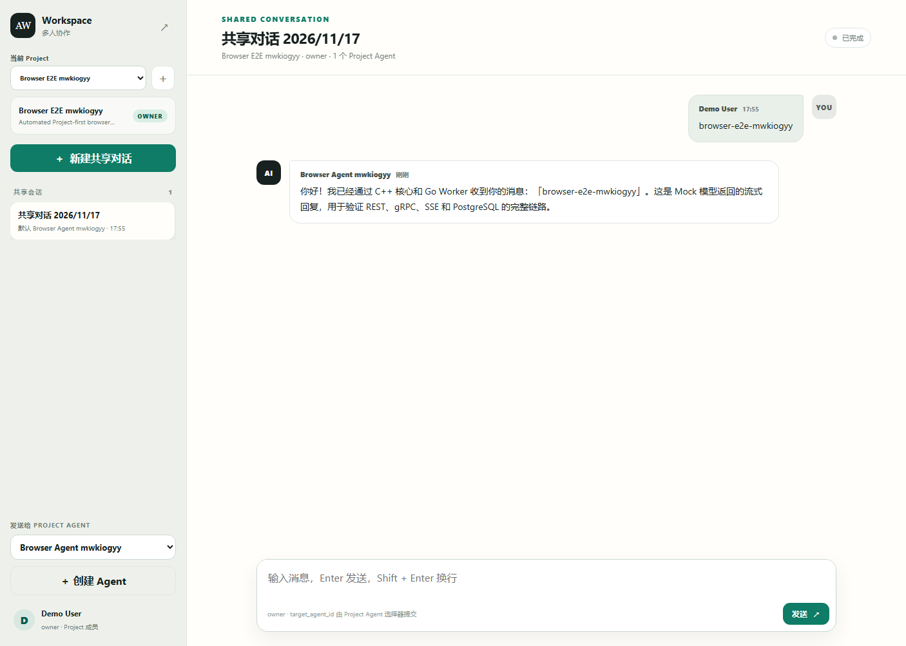
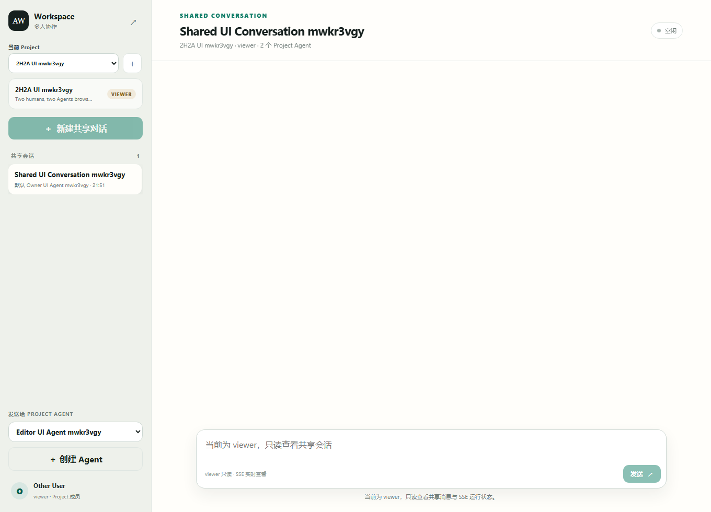

# AI Workspace V2.0 · 多人多 Agent 基础对话平台

本仓交付当前最小 MVP：两个人类与两个 Agent 在同一 Project、同一共享 Conversation 中协作。浏览器只连接 C++ Core，C++ 是唯一 PostgreSQL 业务写入者，Go Worker 通过 gRPC 领取 Job 并执行 Mock/兼容模型流式调用。

当前状态：`V0.2.0` 候选为 `REVIEW`；分支已推送 `origin`，尚未合并 `main`，尚未创建 `V0.2.0` tag。验收事实见 `docs/acceptance/V0.2-multiplayer-mvp.md`。

```text
Browser -> C++ HTTP/SSE :8080 -> PostgreSQL :5432
                         \-> gRPC :50051 -> Go Worker -> model HTTPS / mock model
```

## 已实现

- Project 创建/列表/详情；owner/editor/viewer 角色与成员管理。
- Agent 所有权和 Project Agent 映射；只有 Agent owner 能加入自己的 Agent。
- Project-first 共享 Conversation、共享 Message 历史、必填 `target_agent_id`。
- 同一 Conversation 单 active Run；发送/retry 冲突返回 409。
- Project member Run/SSE 权限；owner/editor 操作自己的 Run，owner 可操作任意 Run，viewer 只读。
- 原生 HTML/CSS/JavaScript Project-first 工作台、目标 Agent 选择、共享 SSE 发现与断线回放。
- Docker-first 启动、Docker/浏览器 E2E、迁移重放、health 与演示脚本。

## 快速启动

```powershell
./scripts/setup-dev.ps1 -Up
```

浏览器打开 `http://localhost:8080`。本地演示账号：

```text
owner:  demo  / demo1234
editor: other / demo1234
```

这些账号只用于本地验收，不得作为生产凭据。

## 2H+2A 本地演示

服务启动后生成/复用演示 Project、两个 Agent、共享 Conversation 和四条消息：

```powershell
./scripts/demo-2h2a.ps1 -Docker
```

脚本输出 `project_id`、`conversation_id`、账号和消息数；重复运行会复用同一演示数据并补齐缺失部分。浏览器中两个账号应能看到同一个 `2H+2A 本地演示` Project 和 `共享协作演示` Conversation。

完整演示步骤见 `docs/runbook/A15-multiplayer-demo.md`。

## 验证

Docker-first 全量：

```powershell
./scripts/test.ps1 -Docker
```

包含契约、Go Worker test/vet、前端状态、单用户 E2E、2H+2A API E2E、Project 权限 fixture、审计与迁移重放。

浏览器 E2E：

```powershell
./scripts/frontend-e2e.ps1
./scripts/frontend-2h2a-e2e.ps1
```

浏览器脚本使用本机 Edge/Chrome 的 headless CDP，不新增 npm 依赖；可用 `BROWSER_BIN` 指定路径。

专项：

```powershell
./scripts/test-migrations.ps1 -Docker
./scripts/test-health.ps1
./scripts/test-lease.ps1
```

## 证据





- `docs/evidence/ui-project-first.png`
- `docs/evidence/ui-2h2a.png`
- `docs/evidence/demo-2h2a-report.json`
- `docs/evidence/health-response.json`
- `docs/acceptance/V0.2-multiplayer-mvp.md`

## 文档索引

- REST：`api/openapi.yaml`
- gRPC：`proto/workspace.proto`
- SSE：`docs/contracts/sse-events.md`
- 错误码：`docs/contracts/error-codes.md`
- 数据设计：`docs/schema/erd.md`
- 部署与运维：`docs/runbook/A03-deployment.md`、`docs/runbook/A14-operations.md`
- 2H+2A 演示：`docs/runbook/A15-multiplayer-demo.md`
- 交接记录：`docs/handoffs/`

## 当前限制

- 未实现 Task/Handoff、文件、共享记忆、插件、诊断、匹配、Agreement、Trial 或多 Run 并行。
- Project 归档策略已写入最小 MVP PRD，但冻结 OpenAPI 没有归档路由，当前也没有运行时入口；补齐需另行批准版本化契约变更。
- 新 Run 的跨成员发现依赖活动 Conversation 的短轮询；Run 事件本身仍使用冻结的 SSE 契约与持久化游标。
- 生产部署仍需 HTTPS 反向代理、账号管理、Worker 扩容与备份策略。
