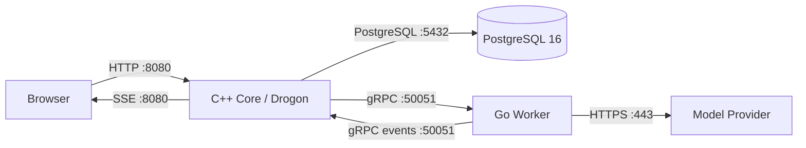

# A03 部署架构 V1.0

## 1. 进程与端口



| 进程 | 监听 | 宿主机发布 | 允许访问者 |
|---|---|---|---|
| C++ Core | 8080, 50051 | 仅 8080 | Browser / Worker |
| Go Worker | 无入站端口 | 无 | 仅出站至 C++、模型 |
| PostgreSQL | 5432 | 无 | 仅 C++ |
| Model API | 443 | 无入站 | 仅 Worker |

生产环境必须在 443 终止 TLS 并反向代理至 C++ 8080。`50051`、`5432` 只存在于容器内部网络。

## 2. Compose 拓扑

- `postgres`：持久卷 `workspace_pgdata`，健康检查 `pg_isready`。
- `core`：只读根文件系统；启动时由 C++ 执行 `db/migrations/*.sql` 幂等迁移。
- `worker`：只读根文件系统；仅环境变量持有模型密钥。
- 所有服务使用内部 DNS；仅 `core:8080` 映射到宿主机。

## 3. 启动

```powershell
Copy-Item .env.example .env
docker compose --env-file .env -f deploy/docker-compose.yml up --build -d
docker compose --env-file .env -f deploy/docker-compose.yml ps
```

打开 `http://localhost:8080`，演示账号 `demo / demo123`。

## 4. 网络与安全边界

- 不发布 `50051`、`5432`。
- `MODEL_API_KEY` 只注入 Worker，不进入前端、数据库、Compose YAML 明文或镜像层。
- Core 以非 root 用户运行；数据库密码由环境注入。
- 生产将 `COOKIE_SECURE=true`、`APP_ORIGIN=https://实际域名`，并在反向代理配置 SSE：
  - `proxy_buffering off`
  - `proxy_read_timeout 300s`
  - 保持 C++ 为唯一上游业务服务。