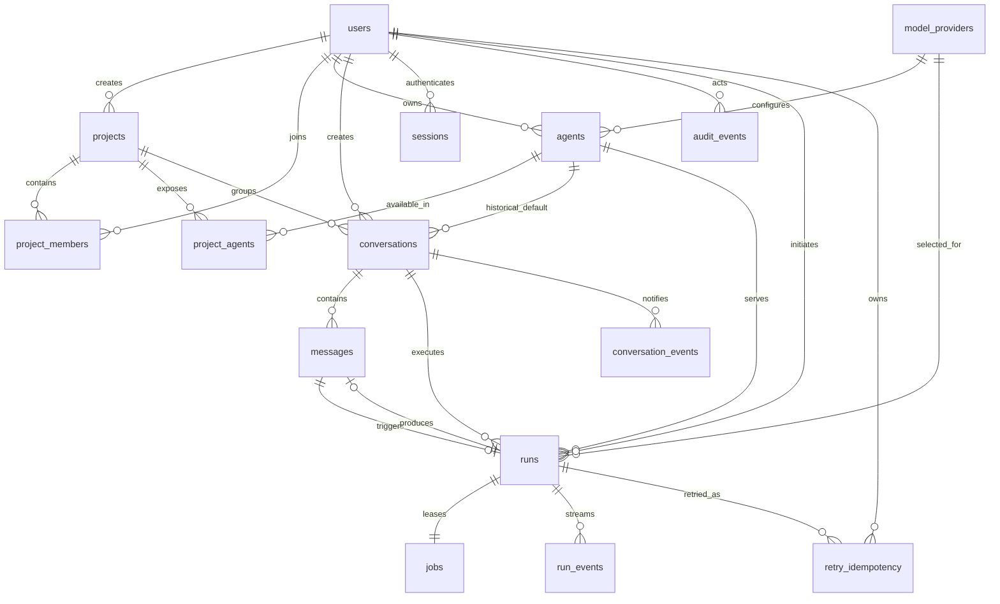

# 数据库 ER 设计 V1.1.0

- 数据库：PostgreSQL 16+
- 迁移：`db/migrations/001_init.sql` 至 `009_conversation_events.sql`
- 唯一业务写入者：C++ Core
- Worker 禁止连接 PostgreSQL

## 1. ER 图

## 2. 不变量

- Project 成员可见 Project 下全部 Conversation、Message，并可订阅该 Project 下 Run 的 SSE；不建立 `conversation_members`。
- `conversations.owner_id` 保留为创建者字段，不再作为权限归属；`conversations.agent_id` 保留为历史默认 Agent 字段。
- 新消息请求必须携带 `client_request_id` 和 `target_agent_id`；目标 Agent 写入 `runs.agent_id`，`target_agent_id` 不是 `messages` 表字段。
- 一个 Conversation 同时最多一个 `status IN ('queued','running')` 的 Run；当前由 Project + Conversation 行锁和 409 返回保证。
- `messages.client_request_id` 按 `(conversation_id, sender_id, client_request_id)` 唯一，不同用户可使用相同客户端请求 ID；同一用户重复请求返回原消息和 Run。
- `runs.initiated_by_user_id` 表示实际发起或重试该 Run 的用户；`trigger_message_id` 保留不可变的原始触发消息。历史 Run 按触发消息作者回填。
- Project 内一个用户只有一个角色；至少一个 `owner` 由应用事务保证。不能移除或降级最后一个 owner。
- Agent 继续由 `agents.owner_id` 拥有；加入 Project 不转让所有权。Agent owner 必须是 Project 成员，且只有 owner 自己能执行加入操作。
- 一个用户消息、Run、Job 在同一事务创建。
- 每个 Run 恰好一个 Job；重试创建新 Run，不复用旧 Job。
- 每个 Run 最多一条 assistant 最终消息，由 `ux_messages_assistant_run` 保证。
- Retry Idempotency-Key 在用户范围内唯一；重复 key 返回首次创建的 Run。
- `(run_id, seq)` 唯一；终态事件按 `run_id + event_type` 唯一。
- `(conversation_id, seq)` 唯一；`conversation_events` 只记录 `run.available`，由 C++ 在创建/重试 Run 的同一事务写入。
- 消息只追加；正文不进入审计，`audit_events.metadata_jsonb` 禁止放正文和密钥。

## 3. 分阶段迁移边界

`006_multiplayer_foundation.sql` 完成增量数据冻结与回填：

- 为已有 Agent/Conversation owner 创建确定性 legacy Project；
- 写入 owner 成员关系与 Project Agent 映射；
- 回填 `conversations.project_id`。

工程包 C 的 `007_conversation_project_required.sql` 在兼容 Conversation 写入已切换为始终提供 `project_id` 后，将 `conversations.project_id` 收紧为 `NOT NULL`。`008_run_initiated_by.sql` 新增并回填 `runs.initiated_by_user_id`；`009_conversation_events.sql` 新增 Conversation 级可回放事件表。Package B/C 已完成 Project-first Conversation 路由、Project membership 运行权限，以及基于 Project + Conversation 行锁的单 active Run 事务。迁移不得删除现有数据，也不得修改既有迁移。

## 4. 权限查询约束

| 对象 | 目标授权条件 |
|---|---|
| Project | `project_members.user_id = current_user_id` |
| Project Member/Agent 列表 | 当前用户是 Project member |
| Conversation | 当前用户是 `conversations.project_id` 对应 Project 的 member |
| Message | 所属 Conversation 的 Project 对当前用户可见 |
| Agent 使用 | Agent 在 `project_agents` 中且 active；发送者角色为 owner/editor |
| Run / SSE / Conversation events | 所属 Conversation 的 Project 对当前用户可见；viewer 只读，非成员 403 |
| Run 取消/重试 | owner/editor 操作 `runs.initiated_by_user_id = current_user_id` 的 Run；owner 可操作任意 Run |
| Job / run_events | 仅内部 Worker 凭短期 lease 访问 |

## 5. 当前实现状态

工程包 B/C 已实现 Project、ProjectMember、ProjectAgent 路由、角色授权、最后 owner 保护、active Run 移除保护和成员移除后的 Agent 映射清理，以及共享 Conversation、必填 `client_request_id`/`target_agent_id` 发送、Conversation/Message/Run/SSE 的 Project 授权和显式 Run 发起者。Project 支持 owner-only 软归档与脱敏审计读取；归档后读取保留、写操作 409。原生前端已接入 Project-first 路由、必填发送字段、审计/归档入口和 Conversation `run.available` 实时发现；2.5 秒消息轮询保留为兜底。
