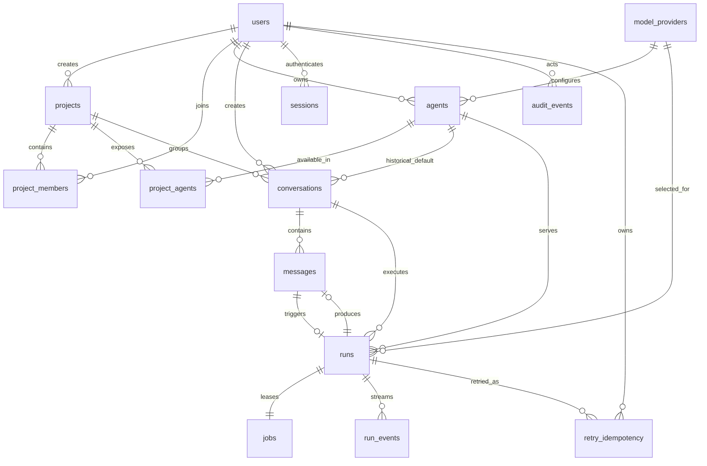

# 数据库 ER 设计 V1.1.0

- 数据库：PostgreSQL 16+
- 迁移：`db/migrations/001_init.sql` 至 `006_multiplayer_foundation.sql`
- 唯一业务写入者：C++ Core
- Worker 禁止连接 PostgreSQL

## 1. ER 图

## 2. 不变量

- Project 成员可见 Project 下全部 Conversation、Message，并可订阅该 Project 下 Run 的 SSE；不建立 `conversation_members`。
- `conversations.owner_id` 保留为创建者字段，不再作为权限归属；`conversations.agent_id` 保留为历史默认 Agent 字段。
- 新消息请求必须携带 `target_agent_id`；该值写入对应 Run 的 `runs.agent_id`。`target_agent_id` 是请求字段，不是 `messages` 表字段。
- 一个 Conversation 同时最多一个 `status IN ('queued','running')` 的 Run；工程包 B/C 必须在创建 Run 的事务中使用发送锁并返回 409。工程包 A 不提前增加会破坏现有单用户链路的数据库约束。
- `messages.client_request_id` 按 `(conversation_id, sender_id, client_request_id)` 唯一，不同用户可使用相同客户端请求 ID。
- Project 内一个用户只有一个角色；至少一个 `owner` 由应用事务保证。不能移除或降级最后一个 owner。
- Agent 继续由 `agents.owner_id` 拥有；加入 Project 不转让所有权。Agent owner 必须是 Project 成员，且只有 owner 自己能执行加入操作。
- 一个用户消息、Run、Job 在同一事务创建。
- 每个 Run 恰好一个 Job；重试创建新 Run，不复用旧 Job。
- 每个 Run 最多一条 assistant 最终消息，由 `ux_messages_assistant_run` 保证。
- Retry Idempotency-Key 在用户范围内唯一；重复 key 返回首次创建的 Run。
- `(run_id, seq)` 唯一；终态事件按 `run_id + event_type` 唯一。
- 消息只追加；正文不进入审计，`audit_events.metadata_jsonb` 禁止放正文和密钥。

## 3. 分阶段迁移边界

`006_multiplayer_foundation.sql` 只做增量数据冻结与回填：

- 为已有 Agent/Conversation owner 创建确定性 legacy Project；
- 写入 owner 成员关系与 Project Agent 映射；
- 回填 `conversations.project_id`；
- 暂不将 `conversations.project_id` 设为 `NOT NULL`，因为现有 C++ 创建会话路径尚未切换到 Project。

`conversations.project_id NOT NULL` 与业务写入切换属于工程包 B/C，不属于模型变更。迁移不得删除现有数据，也不得修改 `001` 至 `005`。

## 4. 权限查询约束

| 对象 | 目标授权条件 |
|---|---|
| Project | `project_members.user_id = current_user_id` |
| Project Member/Agent 列表 | 当前用户是 Project member |
| Conversation | 当前用户是 `conversations.project_id` 对应 Project 的 member |
| Message | 所属 Conversation 的 Project 对当前用户可见 |
| Agent 使用 | Agent 在 `project_agents` 中且 active；发送者角色为 owner/editor |
| Run / SSE | 所属 Conversation 的 Project 对当前用户可见；viewer 只读 |
| Run 取消/重试 | owner/editor 操作自己的 Run；owner 可操作任意 Run |
| Job / run_events | 仅内部 Worker 凭短期 lease 访问 |

## 5. 当前实现状态

本文件冻结的是工程包 A 的目标数据与权限语义。Project 路由、Project 成员授权和共享 Conversation 运行时尚未实现；工程包 B/C 完成切换前，现有 C++ 实现仍保持单 Owner 资源隔离。不得据本文档宣称多人 Project 已运行时可用。
