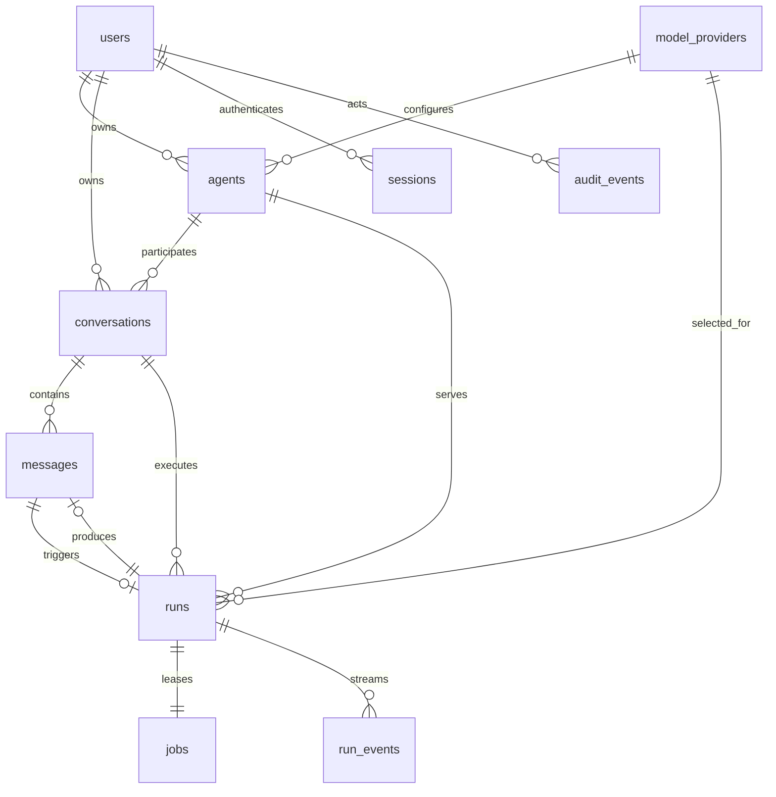

# 数据库 ER 设计 V1.0.0

- 数据库：PostgreSQL 16+
- 迁移：`db/migrations/001_init.sql`、`002_seed.sql`
- 唯一业务写入者：C++ Core
- Worker 禁止连接 PostgreSQL

## 1. ER 图

## 2. 不变量

- `messages.seq` 全局单调；会话内按 `seq` 排序稳定。
- 一个用户消息、Run、Job 在同一事务创建。
- 每个 Run 恰好一个 Job；重试创建新 Run，不复用旧 Job。
- 每个 Run 最多一条 assistant 最终消息，由 `ux_messages_assistant_run` 保证。
- `(run_id, seq)` 唯一；终态事件按 `run_id + event_type` 唯一。
- `project_id` 本轮仅预留可空字段，不建立 Team/Project 功能。
- 消息正文不进入审计；`audit_events.metadata_jsonb` 禁止放正文和密钥。

## 3. 权限查询约束

| 对象 | 授权条件 |
|---|---|
| Agent | `agents.owner_id = current_user_id` |
| Conversation | `conversations.owner_id = current_user_id` |
| Message | 会话归属当前用户 |
| Run | Run 所属会话归属当前用户 |
| Job / run_events | 仅内部 Worker 凭租约访问 |